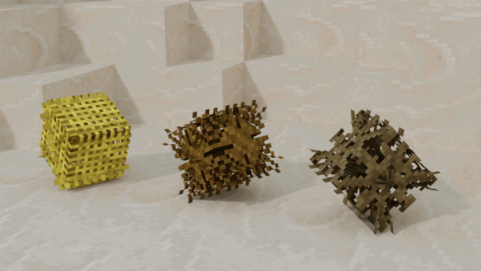

# X Tumbleweed (`x_tumbleweed`)

[](https://content.luanti.org/packages/SaKeL/x_tumbleweed/)
[](https://content.luanti.org/packages/SaKeL/x_tumbleweed/)

[](https://github.com/sakel-hub/x_tumbleweed/actions)
[](LICENSE.txt)
[](LICENSE.txt)
[](https://github.com/sakel-hub/x_tumbleweed/pulls)


Brings arid lands to life with lively, wind-blown tumbleweeds that bounce and tumble across vast desert sands, leap over rocky ledges, split into baby tumbleweeds, and drop useful desert flora for thirsty explorers.



## Gameplay & Features

### 🌾 Bouncing & Rolling Across the Dunes
Tumbleweeds are swept along by desert breezes with authentic, bouncy locomotion. Instead of sliding flat across the ground, they continuously hop, skip, and roll over sand ripples, kicking up little puffs of dust with every bounce. They easily hop over small rocks and low ledges, glance off canyon walls, and tumble naturally down steep dunes without getting stuck.

### ⚽ Interactive Desert Fun (Bat Them Around!)
Walk up to a tumbleweed and give it a punch or swat it with a shovel! Tumbleweeds absorb your hit and launch sailing across the sands in the direction you hit them. Play an impromptu game of desert soccer with fellow explorers, herd a bunch of them into a pen, or swat one out of your campsite.

### 🐣 The Great Scatter: Baby Tumbleweeds!
Cracking open a full-grown tumbleweed can hold an unexpected surprise: **1 in 3 tumbleweeds will burst into four energetic baby tumbleweeds**! These miniature tumbleweeds instantly scatter in all directions, rolling and bouncing merrily across the dunes.

### 🌵 Desert Foraging & Survival Drops
Surviving in sun-scorched wastelands is tough, but tumbleweeds can be a lifesaver. As they roll across the landscape, they sweep up and preserve regional plant life. Breaking a tumbleweed open yields sticks and native desert flora matching whichever biome you are currently exploring (such as dry shrubs, marram grass, or desert cacti). Striking them with tools yields higher harvests, with better tool materials providing even richer forage.

### 🎨 Natural Variety & Camouflage Disguises
No two tumbleweeds look quite alike. They spawn in varying sizes, from tiny roadside bushes to giant rolling brambles. While most display classic sun-baked dried brush textures, rare tumbleweeds pick up the natural colors of the ground beneath them, blending seamlessly into red desert sand or pale dunes.

### 💧 Water Soluble
Bone-dry and brittle, tumbleweeds are fundamentally allergic to water! If a strong gust blows one into an oasis, river, or coastal shore, it immediately dissolves in a soft poof of dust.

---

## Biome Spawning & Compatibility

Tumbleweeds naturally populate dry, sandy, and arid regions:
- **Standard Deserts** (`desert`, `sand_desert`)
- **Sandstone Canyons & Wastes** (`sandstone_desert`)
- **Cold & Arid Expanses** (`cold_desert`)

### 🌍 Zero-Config Auto-Discovery
`x_tumbleweed` automatically discovers desert, dune, and arid biomes added by custom mapgens and world mods (such as **Everness** or community biome packs) as soon as your world loads. It seamlessly populates them with zero setup required and zero mod dependencies.

---

## Modder API

If you are developing a custom biome mod and want to explicitly invite tumbleweeds to roam your new territory, simply register your biome names:

```lua
if core.global_exists("XTumbleweed") then
    XTumbleweed:add_allowed_biomes({
        "my_mod:salt_flats",
        "my_mod:red_dunes",
    })
end
```

---

## Requirements & Compatibility

- **Required Mod**: [x_mob_core](https://content.luanti.org/packages/SaKeL/x_mob_core/) (2.0.0+)
- **Optional**: `default` (from Minetest Game for standard desert nodes and foliage)
- **Engine**: Luanti 5.10 or newer

---

## Human Authorship Certification (Zero AI)

This project is entirely handcrafted. Every line of code, commit, configuration, documentation, and creative asset was designed, authored, and verified solely by human maintainers. No generative AI or automated generation tools were used at any stage of development.

## Credits & License

### Code
- GNU Lesser General Public License v2.1 or later (see [LICENSE.txt](LICENSE.txt)).
- Author: **SaKeL** (refactored to `x_mob_core` architecture).

### Media & Textures
- `x_tumbleweed_death_particle_animated.png`: CC-BY-SA-4.0 by **XSSheep**
- `x_tumbleweed_tumbleweed_1.png` – `3.png`: CC-BY-SA-4.0 by **SaKeL**
- `x_tumbleweed_tumbleweed_mask_1.png` – `3.png`: CC-BY-SA-4.0 by **SaKeL**

### 3D Models
- `x_tumbleweed_tumbleweed.b3d`: CC-BY-SA-4.0 by **SaKeL**

### Audio
- `x_tumbleweed_tumbleweed.1.ogg` – `3.ogg`: CC-BY-4.0 by **duckduckpony**
